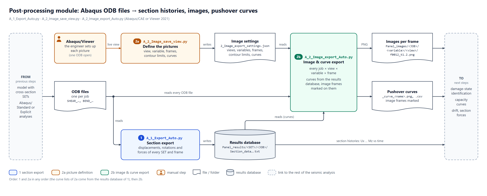

# Abaqus scripts for output processing

Python scripts for **Abaqus/CAE and Abaqus/Viewer** that automate a numerical (seismic, pushover)
analysis of structures modelled with **volumetric or shell elements**: prepare the model, run a
parameter study, export the forces and displacements of cross-sections, and export images and
pushover curves. Made for civil-engineering analyses of buildings and benchmarks (walls, piers,
spandrels), usable wherever section forces and displacements are needed.

> **Check your results.** As with any automated post-processing, verify the exported forces and
> displacements on a few sections (e.g. against a free-body cut in Abaqus/Viewer) before relying on them.

## Workflow

| Step | Folder | Script(s) | What it does |
|---|---|---|---|
| 1 | [`1_model_preparation`](1_model_preparation) | `prepare_model_for_export.py` `convert_models_to_explicit_EXAMPLE.py` | checks the cross-section SETs (names, field output); example of converting models to Abaqus/Explicit |
| 2 | [`2_run_analyses`](2_run_analyses) | `run_jobs.py` (+ `material_CDP`) | parameter study: one job per model and value (vertical force, contact properties or CDP material), already finished jobs are skipped |
| 3 | [`3_export_and_image_export`](3_export_and_image_export) | `A_1_Export_Auto.py` | displacements, rotations and forces of every cross-section and frame &rarr; results database (text files) |
| 4 | [`3_export_and_image_export`](3_export_and_image_export) | `A_2_Image_save_view.py` `A_2_Image_export_Auto.py` | define the pictures once in Abaqus/Viewer, then print them for every job and frame; pushover curves with the image frames marked |

Steps 3 and 4 share one library (`A_IMPORT_additional_functions`): copy everything in
`3_export_and_image_export` whose name starts with **A_** into the folder with the ODB files.
A detailed flowchart and a short report of steps 3 and 4 are in [`docs/flowchart`](docs/flowchart)
(PDF, PNG, SVG, HTML, editable Visio and draw.io files).

## Quick start

1. **Model** (Abaqus/CAE): define every cross-section as an assembly SET named
   `TYPE&LABEL&INDEX&ANGLE`, e.g. `V_PIER&RU&2&0` (see [cross-section SETs](#cross-section-sets));
   request field output `U` and `NFORC` (and `UR` for shell sections, plus the variables you want
   in the images). Run `1_model_preparation/prepare_model_for_export.py` to check the SET names.
2. **Analyses** (Abaqus/CAE): set `STUDY`, `MODELS` and the values at the top of
   `2_run_analyses/run_jobs.py`, open the .cae and run it (File > Run Script).
3. **Section export** (Abaqus/CAE or Viewer): copy the A_ files next to the ODB files and run
   `A_1_Export_Auto.py`; choose ODB files, step and methods in its dialog.
   Result: `Panel_results/<SET>/<JOB>/Section_data...txt`.
4. **Images and curves** (Abaqus/Viewer): set up a picture, run `A_2_Image_save_view.py`
   (repeat per picture; the 4th field `edit` defines the pushover curves), then run
   `A_2_Image_export_Auto.py`. Result: `Panel_images/<JOB>/<variable>/<view>/f0012_t1.2.png`
   and `Panel_images/<JOB>/_curve_<name>.png`.

Each script has an **INPUT** block at the top and a description of every option; the settings of
steps 3 and 4 are remembered between runs (`*_settings.json` next to the scripts).

## Cross-section SETs

A cross-section is a node set (nodes on the cut) and an element set (elements on one side of the
cut) with the same name, at assembly level, named `TYPE&LABEL&INDEX&ANGLE`:

| TYPE | geometry | local axes | forces |
|---|---|---|---|
| `V_PIER`, `V_SPEC` | volume (solid elements) | pier | yes |
| `S_PIER` | shell (line of nodes) | pier | yes |
| `V_SPANDREL` | volume | spandrel | yes |
| `S_SPANDREL` | shell | spandrel | yes |
| `S_DRIFT` | point (average of the nodes) | global | no |
| `SRIFT` | volume | pier | no |

`LABEL` is free text, `INDEX` numbers the sections (e.g. 1 = bottom, 2 = top of a pier) and
`ANGLE` turns the local axes about the global Z axis (degrees) for displacements and forces.

## Output

* **Section histories** per SET and job: `Time, frameId, Ux, Uy, Uz, fix, fiy, fiz, Fx, Fy, Fz, Mx, My, Mz`
  (rotations by a rigid-body fit that is valid for large rotations; forces by an Abaqus free-body
  cut or by summing NFORC). Frames of displacements and forces are matched by their position.
* **Images** per job, variable, view and frame (camera, section cuts, display group, contour limits
  as set up in Abaqus/Viewer).
* **Curves** per job (e.g. Fx of one section vs. the relative displacement of two sections), with the
  frames of the images marked, as PNG and CSV.

## Requirements

* Abaqus/CAE or Abaqus/Viewer 2021 (Python 2.7.15), Windows 10. The scripts are written to also
  run with the Python 3 of Abaqus 2024 and later, but have not been tested there yet.
* Nothing else: the plots use the matplotlib that comes with Abaqus.

## Video tutorials

The videos were recorded with the **earlier version** of the scripts: the modelling (SETs, naming,
local axes) is the same, the script names and the input differ (no `Input_file.txt` any more - the
scripts have an INPUT block and remember their settings).

* How the scripts work - general overview and demonstration, from a new model to extracted results: https://youtu.be/g9gw_EXEesM
* Creation of the benchmark model: https://youtu.be/stwDfm0-Hc0
* Cross-section naming and local axes: https://youtu.be/6BFI6Eegp64
* Export script: https://youtu.be/nRnF_rlyfsg
* Displacement and force conversion modification demo: https://youtu.be/nNw8NbOuac0
* Automated job running: https://youtu.be/iR5NVptAlkw
* Adding a custom post-processing function: https://youtu.be/oXEkcqDdTa8
* Entire playlist: https://www.youtube.com/playlist?list=PLjdnR7Fv3RGjCVFS0ykvkd6-2jo0IHgPl

A written tutorial (PDF with pictures) is planned, see [`docs/tutorial`](docs/tutorial).
The texts of the earlier README files are kept in [`readme.txt`](readme.txt).

## Citation and contact

The scripts are to be published in an article, which will be linked here; if you use them in
research, please reference it. Questions and suggestions: romano.jevtic.rundek@grad.unizg.hr.
If you make a notable adaptation of the scripts, publishing it as a branch or fork of this
repository is welcome.

## License

MIT, see [LICENSE](LICENSE).
